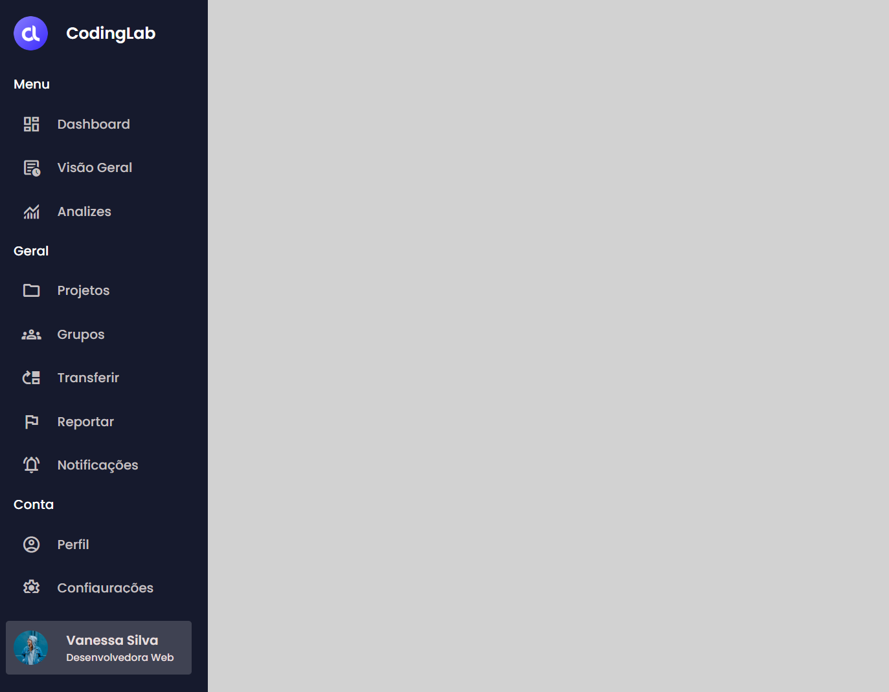

# 🧭 Barra de Navegação Lateral

Projeto de uma barra de navegação lateral interativa, desenvolvido com **HTML5 e CSS3** como parte de uma atividade prática do curso PROA.

O projeto tem como objetivo explorar conceitos de criação de menus laterais, organização de interfaces administrativas e efeitos de expansão, utilizando uma sidebar que revela suas opções de navegação ao passar o mouse.

## 🖥️ Prévia do projeto

  

🔗 **[Acesse o projeto online](https://gabrielc0liveira.github.io/Projeto11Proa-BarradeMenudeNavegacaoLateral/)**

## Funcionalidades e características

- Barra de navegação lateral com expansão automática ao passar o mouse.
- Menu compacto de 85px que se expande para 260px.
- Animação suave de expansão utilizando transições CSS.
- Organização dos itens de navegação nas categorias Menu, Geral e Conta.
- Utilização de ícones para representar as opções de navegação.
- Efeitos visuais ao passar o mouse sobre os links.
- Exibição de informações de perfil com foto, nome e função.
- Separadores visuais que desaparecem durante a expansão do menu.
- Rolagem vertical interna para acomodar os itens de navegação.
- Interface desenvolvida inteiramente com HTML e CSS, sem JavaScript.

## Tecnologias utilizadas

- **HTML5:** estruturação da barra lateral, dos links e das informações de perfil.
- **CSS3:** estilização, posicionamento, expansão do menu e efeitos interativos.
- **Google Material Symbols:** utilização de ícones nos itens de navegação.
- **Google Fonts:** utilização da fonte Poppins.

## Aprendizados

Durante o desenvolvimento, foram praticados conceitos como:

- Estruturação de menus laterais utilizando HTML e a tag `aside`.
- Organização de elementos utilizando Flexbox.
- Criação de barras de navegação fixas com `position: fixed`.
- Desenvolvimento de efeitos de expansão utilizando `transition` e `hover`.
- Manipulação de largura, opacidade e visibilidade dos elementos.
- Utilização de `overflow-x` e `overflow-y` para controlar o conteúdo.
- Personalização de links, separadores e elementos de perfil.
- Organização de interfaces inspiradas em dashboards administrativos.

## 📂 Como executar o projeto

🔗 **[Acesse o projeto online](https://gabrielc0liveira.github.io/Projeto11Proa-BarradeMenudeNavegacaoLateral/)**

---

Desenvolvido por **Gabriel Oliveira** como parte das atividades práticas do PROA.
